 

<h2 align="center">✦ Prologue ✦</h2>

  <i>A Computer Engineering student who finds beauty in clean architecture, 
  quiet data, and models that learn from the dark.</i>

  During my <b>Erasmus+ traineeship at the University of Szeged</b> in Hungary, 
  I studied the performance of selected <b>European Digital Identity (EUDI) Wallet</b> workflows — 
  measuring latency the way a scholar measures time: patiently, and with great attention to detail.

  

<h2 align="center">☾ The Collection ☾</h2>

<i>Selected volumes from my library</i>

<table align="center">
  <tr>
    <td width="50%" valign="top">
      
⚜ VOLUME I ⚜

      <h3 align="center"><a href="https://github.com/03betulpehlivan/breast-cancer-histopathology-classification">Breast Cancer Histopathology Classification</a></h3>
      
<i>Deep-learning image classification using Vision Transformers, Swin Transformer, ConvNeXt, feature fusion, and machine-learning classifiers.</i>

      

        
        
        
        
      

    </td>
    <td width="50%" valign="top">
      
⚜ VOLUME II ⚜

      <h3 align="center"><a href="https://github.com/03betulpehlivan/eudi-wallet-performance-benchmark">EUDI Wallet Performance Benchmark</a></h3>
      
<i>Performance benchmarking and latency analysis of selected EUDI Wallet issuance and verification workflows, developed during my Erasmus+ traineeship.</i>

      

        
        
        
        
      

    </td>
  </tr>
  <tr>
    <td width="50%" valign="top">
      
⚜ VOLUME III ⚜

      <h3 align="center"><a href="https://github.com/03betulpehlivan/turkey-gold-price-forecast">Turkey Gold Price Forecast</a></h3>
      
<i>An ongoing machine-learning project exploring Turkish gram gold prices using historical data and relevant market indicators.</i>

      

        
        
        
        
      

    </td>
    <td width="50%" valign="top">
      
⚜ VOLUME IV ⚜

      <h3 align="center"><a href="https://github.com/03betulpehlivan/WedSync">WedSync</a></h3>
      
<i>A real-time wedding and event platform using ASP.NET Core and SignalR, with live photo sharing and interactive event experiences.</i>

      

        
        
        
      

    </td>
  </tr>
  <tr>
    <td width="50%" valign="top">
      
⚜ VOLUME V ⚜

      <h3 align="center"><a href="https://github.com/03betulpehlivan/Roastify">Roastify</a></h3>
      
<i>A Flutter application combining image analysis with character-driven responses using Gemini and Firebase.</i>

      

        
        
        
        
      

    </td>
    <td width="50%" valign="top">
      
⚜ VOLUME VI ⚜

      <h3 align="center"><a href="https://github.com/03betulpehlivan/turinglab-betulpehlivan">TuringLab</a></h3>
      
<i>A deterministic Turing Machine simulator featuring YAML-based machine definitions.</i>

      

        
        
        
      

    </td>
  </tr>
</table>

  

<h2 align="center">⚗ The Alchemist's Toolkit ⚗</h2>

  
  
  
  
  
  
  
  
  
  
  

  

<h2 align="center">❦ Marginalia ❦</h2>

<i>Notes scribbled in the margins of my repositories</i>

  

  

<h2 align="center">☽ Currently Reading ☽</h2>

<table align="center">
  <tr>
    <td align="center" width="33%" valign="top">
      <b>I. Intelligent Systems</b> 
      <i>Machine learning, model evaluation, and data-driven insights.</i>
    </td>
    <td align="center" width="33%" valign="top">
      <b>II. Software Engineering</b> 
      <i>APIs, backend systems, performance, and reliable architecture.</i>
    </td>
    <td align="center" width="33%" valign="top">
      <b>III. Building &amp; Learning</b> 
      <i>Useful projects, and learning through experimentation.</i>
    </td>
  </tr>
</table>

 

